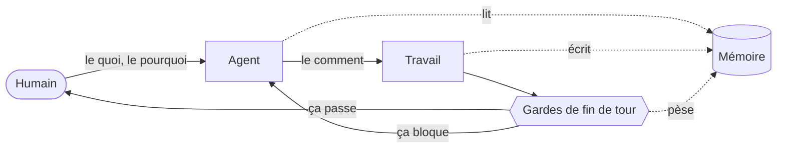
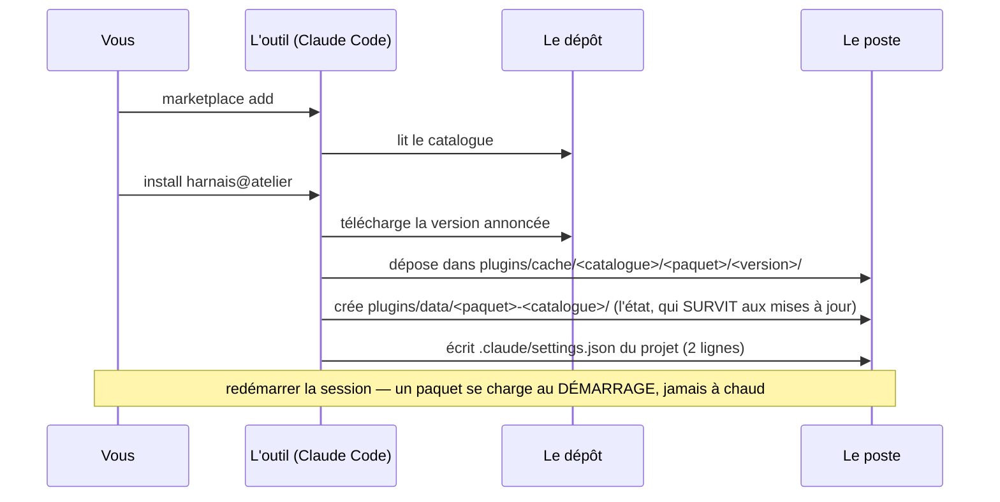
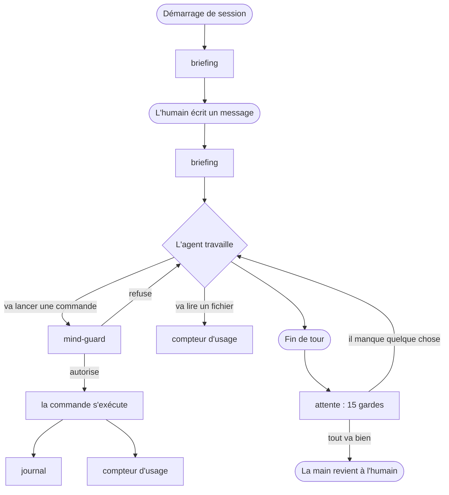
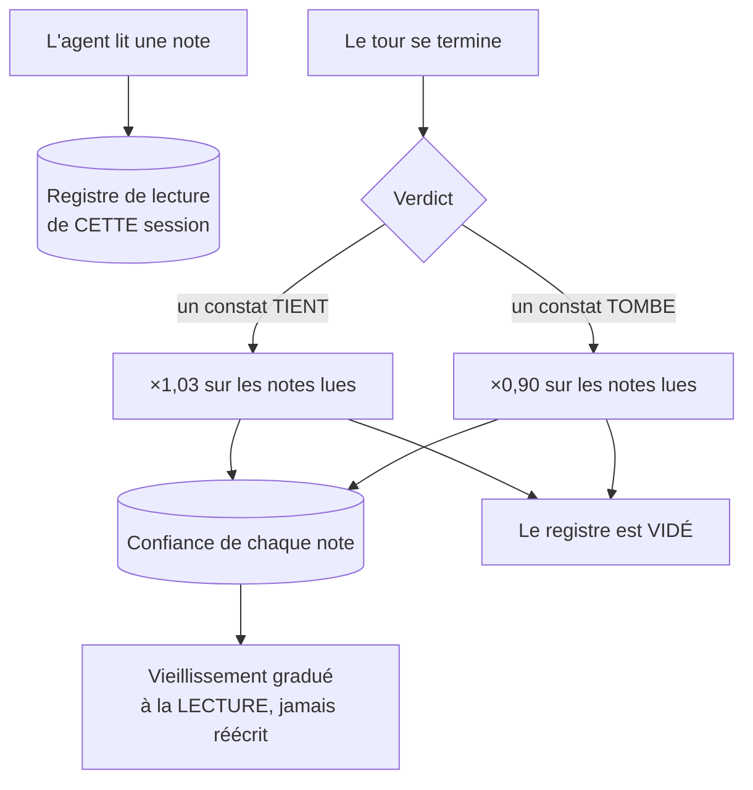
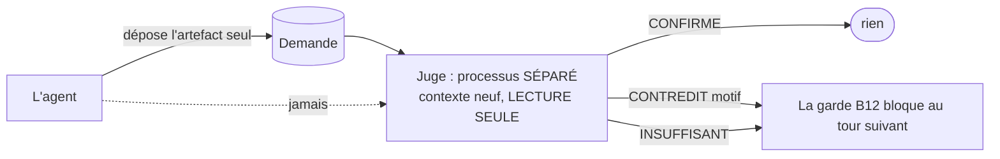
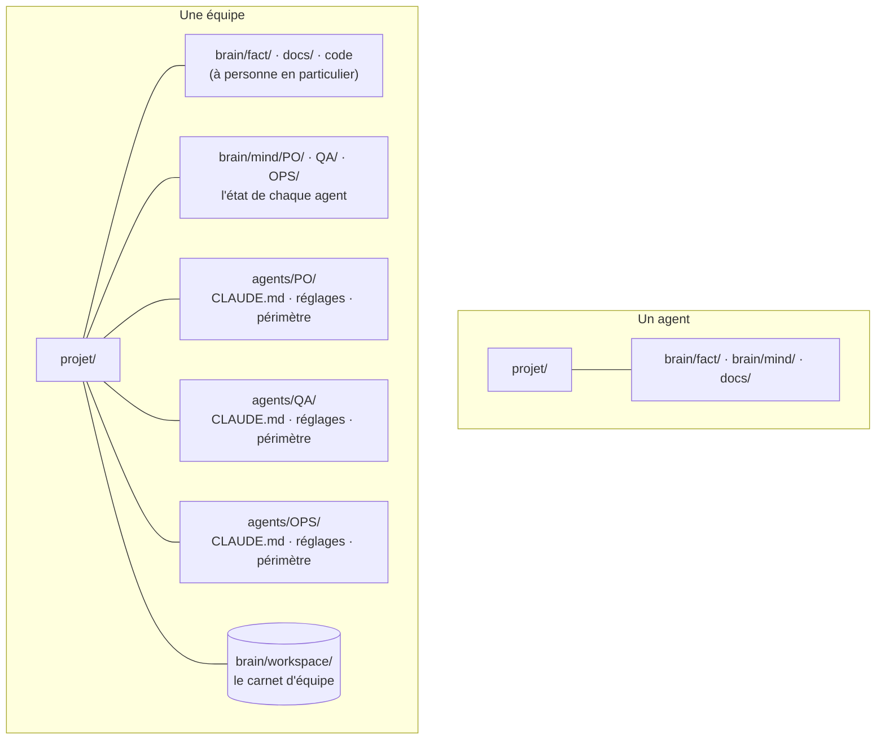

# Le harnais — comment ça marche

> Pour quelqu'un qui n'a jamais vu ni « boucle agentique » ni « harnais ».
> Tout ce qui est chiffré ici a été mesuré ; ce qui ne l'a pas été est nommé.

---

## 1. Le problème, avant la solution

Un agent de code, c'est un modèle de langage à qui on donne un dossier, des
outils (lire, écrire, exécuter) et un but. Il travaille seul, parfois des
heures.

Trois choses tournent mal, toujours les mêmes :

| | ce qui se passe |
|---|---|
| **Il oublie** | chaque session repart de zéro. Ce qu'il a appris hier n'existe plus. |
| **Il affirme** | il annonce « c'est fait, tout marche » sans avoir vérifié — et personne ne le reprend. |
| **Il garde ses questions** | il bute sur une décision qui appartient à l'humain, et l'enterre dans un paragraphe que personne ne lit. |

La réponse habituelle est de **le lui demander** : « pense à vérifier », « pense
à noter ». Ça ne tient pas. Une consigne dans un prompt part **50 à 80 % du
temps** — le modèle décide s'il s'en souvient.

**Le harnais est la réponse inverse : ne rien demander au modèle, et brancher
des déclencheurs que la machine exécute, qu'il le veuille ou non.**

---

## 2. L'idée en une image



Trois boucles imbriquées :

1. **La boucle courte** — l'agent travaille, les gardes l'arrêtent s'il s'apprête
   à rendre la main dans un mauvais état. Il repart, corrige, revient.
2. **La boucle de mémoire** — ce qu'il lit est noté ; ce qu'il apprend est écrit ;
   ce qui n'a jamais servi s'endort.
3. **La boucle humaine** — ce qui demande une décision remonte, en question
   fermée, posée dans le message de fin de tour et gardée dans le todo de
   l'agent — le seul endroit où elle vit (plus de Rappels depuis le 08/10/2026).

---

## 3. Ce qu'on installe

Un **paquet** (un *plugin*). Ce n'est ni un service, ni une bibliothèque, ni un
serveur d'outils que le modèle appellerait s'il y pense. C'est un dossier avec
cinq choses :

```
harnais/
├── .claude-plugin/plugin.json     le nom et le NUMÉRO DE VERSION
├── hooks/hooks.json               « à tel moment, lance telle chose »
├── bin/harnais                    le lanceur (sh) : trouve Python, lance le programme
├── py/                            le programme : du Python, bibliothèque standard seule
└── skills/                        les procédures que l'agent peut suivre
```

**Il faut un vrai Python (3.9 au moins) sur le poste.** Depuis le 12/10/2026 le
programme n'est plus un binaire compilé : c'est `py/*.py`, lu à chaque lancement
(voir §11 pour le pourquoi et le prix). Le lanceur le cherche lui-même, et s'il
n'en trouve pas il le dit — il ne laisse pas les gardes disparaître en silence.

### Les deux commandes

```bash
claude plugin marketplace add <organisation>/<dépôt> --scope project
claude plugin install harnais@atelier --scope project
```

`--scope project` compte : l'installation ne touche **que ce projet**. Les autres
agents de la machine ne bougent pas. C'est ce qui permet d'essayer sans risque.

**La seconde commande se lance dans CHAQUE dossier d'où un agent démarre** — la
racine du projet s'il est seul, chaque `agents/<nom>/` s'ils sont plusieurs.
Mesuré le 11/09/2026 sous Claude Code 2.1.268 : un dossier qui **déclare** le
paquet sans y être **inscrit** ne le charge pas, et rien ne le dit. Déclarer,
c'est une ligne dans les réglages ; inscrire, c'est cette commande. Il faut les
deux.

Puis la mémoire du projet, en un geste :

```bash
harnais adopte          # dit ce qu'il poserait, n'écrit rien
harnais adopte --go     # pose brain/fact/, brain/mind/, et déclare le paquet
```

Purement additif : un fichier qui existe est laissé tel quel. Et pour savoir, à
tout moment, ce qui tourne vraiment : `harnais equipe-vue` lit chaque projet de
l'atelier et dit, pour chaque agent, si le paquet est déclaré, inscrit, et
**servi** — et en quelle version.

### Ce qui se passe exactement



Deux dossiers, et la distinction est la plus importante du système :

- **le cache** contient le **code**. Il est remplacé à chaque mise à jour.
- **les données** contiennent l'**expérience** — ce qui est déjà parti vers
  l'humain, ce qui a été relu, ce qui a servi. **Une mise à jour ne l'emporte
  pas.**

> **Le piège numéro un, mesuré :** le cache est épinglé par le **numéro de
> version**, jamais par le contenu. Publier une correction sans monter le numéro
> laisse la machine sur l'ancien code — et l'outil répond « déjà à jour », sur le
> ton du succès. **Monter la version fait partie de la correction.**

---

## 4. Les huit déclencheurs

Un « hook » est un point du cycle de vie où l'outil exécute une commande. Le
paquet en déclare huit. Chacun reçoit un peu de JSON sur son entrée, et **son
code de sortie décide**. Tous passent par le même lanceur : `sh
${CLAUDE_PLUGIN_ROOT}/bin/harnais <sous-commande>`.



| Moment | Ce qui part | Ce qu'il fait |
|---|---|---|
| démarrage de session | `briefing` | sert l'état du projet : où on en est, ce qui attend une décision |
| chaque message | `briefing` | idem, mais muet en régime établi — il ne se répète pas |
| avant une commande shell | `mind-guard` | peut **refuser** la commande |
| après une commande shell | `journal` | note ce qui a été enregistré |
| après une commande shell | `compteur d'usage` | note qu'une note de mémoire a été lue |
| après une lecture de fichier | `compteur d'usage` | idem, par l'autre porte |
| refus du mode auto | `refus-auto` | note le refus ; la fin de tour le rappelle (voir B17) |
| fin de tour | `attente` | les quinze gardes |

**Le code de sortie est tout le pouvoir du dispositif :**

| code | effet |
|---|---|
| `0` | ça passe |
| `2` | **bloqué** — le message écrit revient à l'agent, qui doit traiter |

C'est la différence entre une consigne et une garde. Une consigne suggère ; une
garde **rend la main impossible** tant que le défaut est là.

> **Règle absolue du harnais : on sort en 0 par défaut.** Un harnais qui empêche
> de travailler est un harnais qu'on finit par désarmer. Les seuls blocages sont
> volontaires et nommés — jamais une panne.

---

## 5. Les quinze gardes de fin de tour

C'est le cœur. Au moment où l'agent s'apprête à rendre la main, quinze questions
sont posées à l'état du projet. Chacune peut le renvoyer travailler. (Les numéros
sautent : B2 et B3 ont été retirées avec les Rappels, B4 n'en garde que la moitié
`!cible`.)

| | Ce qu'elle refuse |
|---|---|
| **B1** | du code a bougé et le fichier de tâches n'a pas suivi |
| **B4** | une demande faite dans la conversation (`!cible`) n'a pas été prise en compte |
| **B5** | un chantier partagé fini sans une ligne au carnet d'équipe |
| **B6** | un fichier de faits touché sans l'autorisation explicite du commanditaire (levée pour un agent expert : noter les faits est son travail) |
| **B7** | un constat posé sans de quoi le **rejouer** plus tard |
| **B8** | une question mal formée : pas fermée, sans dire ce que chaque réponse déclenche |
| **B9** | une vérification qui est **tombée** et qu'on s'apprêtait à ignorer |
| **B10** | une liste de contrôle des rechutes non rejouée avant d'affirmer |
| **B11** | de l'acharnement : trois fois la même approche sans changer de méthode |
| **B12** | un relecteur indépendant a **contredit** une affirmation qui part vers l'humain |
| **B13** | une question **nouvelle** pour l'humain est rangée dans la liste sans être posée dans le message de fin de tour |
| **B14** | sur un projet réglé sur Notion (`HARNAIS_CANAL=notion`) : une question pour l'humain sans le lien de sa ligne dans la base Décisions |
| **B15** | sur une mémoire partagée (`HARNAIS_SYNCHRO=git`) : le travail de l'autre poste n'a pas pu être intégré — le même passage modifié des deux côtés. Rien n'est écrasé ni envoyé ; l'agent le pose à son humain |
| **B16** | sur un agent **expert** (`HARNAIS_PROFIL=expert`) : un fait que l'humain vient de donner n'est noté dans aucune fiche, ou un fait qui identifie quelqu'un est rangé dans une fiche partagée. C'est un juge qui le décide, pas des mots-clés (§6 bis) |
| **B17** | le message final demande à l'humain de **taper une commande** (une ligne ou un bloc qui commence par `!`) — il n'a pas de terminal, il travaille depuis l'app à distance ; ou le mode auto a refusé un geste pendant le tour et le message ne demande pas de passer au **mode edit**. Une seule fois, sans boucle |

### La garde B7, pour comprendre l'esprit

Une **tâche** (« construire X ») reste vraie jusqu'à ce qu'on la fasse. Un
**constat** (« X manque ») peut cesser d'être vrai **tout seul**, sans que
personne y touche. Et un constat bien mesuré n'est pas plus durable qu'un
constat bâclé : seulement plus crédible, donc **plus dangereux quand il périme**.

La garde exige donc, sous chaque constat, de quoi le rejouer :

```
- [ ] !haut @user ?constat  **J'ouvre une page de contact ? oui / non**
      oui → tes clients peuvent t'écrire ; 1 h de travail, en ligne demain.
      non → ils n'ont que le téléphone ; on ferme le sujet.
      ↻ service :: curl -s -o /dev/null -w '%{http_code}' https://x/contact :: ^404$
```

La dernière ligne est rejouée **au moment où la question part vers l'humain**,
et elle a trois issues : **TIENT** · **TOMBÉ** (la question disparaît de sa
liste) · **MUET** (la vérification n'a pas abouti). *Un contrôle qui échoue ne se
lit jamais comme un constat confirmé.*

---

## 6. La mémoire — quatre maisons, et ce que chacune refuse

L'erreur classique est un seul dossier « notes » où tout s'entasse. Le même fait
finit à deux endroits, dans deux versions, et plus personne ne sait laquelle est
vraie. D'où quatre maisons, **et chacune déclare ce qui appartient au voisin**.

| dossier | nature | plafond |
|---|---|---|
| `brain/fact/` | les faits du projet, vrais pour tous ses agents | 4 fichiers, plus `workflow.md` (commun à tous) et `roles.md` en équipe ; un expert : un socle et des fiches libres (§6 bis) |
| `brain/mind/` | l'état d'**un** agent : où il en est, ce qui l'attend | 2 fichiers |
| `docs/` | les traces datées : décisions, journaux | aucun |
| mémoire auto | les **leçons de méthode**, valables hors de ce projet | aucun |

- **`brain/fact/` refuse** ce qui est daté, ce qu'un seul agent tient, et toute
  leçon de méthode.
- **`brain/mind/` refuse** ce qu'un coéquipier doit savoir, et l'historique.
- **`docs/` refuse** ce qui est vrai **maintenant** — un état rangé dans les
  traces se périme sans que personne le voie.
- **La mémoire auto refuse** tout ce qui est propre à un projet. *Test : cette
  phrase resterait-elle utile sur un projet que je n'ai jamais ouvert ?*

**Et si rien ne va, c'est le rangement qui a un trou, pas la phrase.** On la pose
dans `docs/` en le disant, et on le signale.

**L'organisation d'avant se lit toujours.** Avant `brain/`, les faits vivaient
dans `.fact/` et l'état dans `.mind/`, à la racine — ou déportés ensemble dans
un dossier `memoire/`. Le harnais les sert à l'identique, et `harnais
mise-a-niveau` les passe en `brain/` le jour où on le décide — le dossier entier
avec son historique, les droits des agents réécrits vers les nouvelles adresses,
les faits manquants posés ; ce qu'il ne sait pas ranger, il le nomme. Une seule forme
qu'il refuse : **les deux à la fois**, ce qu'une migration interrompue laisse
derrière elle. Servir l'une des deux, ce serait choisir en silence laquelle
fait foi — il ne sert donc aucune mémoire, et le dit.

### Hors mémoire : `assets/`, l'espace des livrables

Ce qu'un agent *produit* — plans, analyses, requêtes, scripts livrés — n'est ni
un fait, ni un état, ni une trace : c'est un **livrable**. Il vit dans `assets/`
(mono-agent) ou `assets/<nom>/` (un dossier par agent), à la racine du projet,
séparé de `docs/` (l'archive) et du code (ce qu'on livre). Le harnais n'y lit
rien ; il sait une seule chose : y modifier un fichier **n'est pas modifier du
code**, donc la garde « du code a bougé sans `todo.md` » ne s'y déclenche pas —
un script SQL livré n'oblige pas à mettre l'état à jour. Seul le dossier de la
racine compte : `src/assets/` d'un site reste du code. Idée née dans le harnais
Copilot (là : `outputs/`) ; le nom `assets/` est celui du commanditaire (12/10/2026).

### Chaque note dit COMMENT elle a été établie

Sur sa première ligne, un mot et un seul :

> **mesuré** · 09/09/2026 — `grep -rc` sur les 34 lignes vivantes de l'atelier

**mesuré** (une commande a rendu ce résultat) · **observé** (vu, sans
instrument) · **lu** (lu dans un document — niveau des experts, depuis le
12/10/2026 ; il part du même poids qu'observé) · **supposé** (déduit, jamais
vérifié) · **dit** (le commanditaire
l'a dit — ça ne se re-mesure pas, ça se re-demande).

**Le troisième champ est le vrai.** Un niveau sans ce qui l'établit est un mot ;
avec, c'est une adresse où retourner voir.

---

## 6 bis. Deux profils d'agent : développeur et expert

Décidé par le commanditaire le 12/10/2026 (« les faits sont différents »). Un développeur
tient les faits d'un projet de code. Un agent qui ne code pas — un juriste, un comptable —
tient le dossier d'un **métier**, et ce dossier n'a pas la forme d'un projet.

| | développeur (le défaut) | expert |
|---|---|---|
| **qui** | QA, OPS, PO, Harness | juriste, comptable, CTO |
| **comment** | rien à déclarer | `HARNAIS_PROFIL=expert` dans les réglages de l'agent, comme `HARNAIS_CANAL` et `HARNAIS_SYNCHRO` |
| **faits** | `base`, `stack`, `rules`, `architecture` (+ `roles` en équipe) | un **socle** : la nature (`base.md`), les sources (`sources.md` : ce qui fait foi, d'où vient le savoir ; `stack.md` en tient lieu chez qui l'a), les règles (`rules.md`) — puis des **fiches libres** au nom du métier (juridique : `societe.md`), sans plafond |
| **commun aux deux** | `workflow.md` — comment procéder : les gestes qu'on ne redécouvre pas | idem |
| **écrire les faits** | à la demande de l'humain : ` # fact-ok` au commit ; un nom nouveau demande ` # fact-neuf` | c'est son travail : la garde de commit et la garde B6 sont levées, et le plafond des noms aussi |
| **fin de tour** | toutes les gardes sauf B16 | toutes, B16 comprise — sauf B6, levée |

**`workflow.md` est le cinquième fichier des faits, pour tous.** Il est né dans un projet
le 12/10/2026 et le commanditaire l'a voulu partout. Le briefing l'annonce
**ABSENT** quand il manque — c'est ce qui pousse à l'écrire — et la garde de
commit l'accepte sans ` # fact-neuf`. La commande d'adoption en pose un **de
départ**, marqué « À REMPLIR », jamais par-dessus un fichier existant.

**Trois états, pour tous les fichiers de faits.** *ABSENT* : il n'existe pas.
*À RENSEIGNER* : il existe mais il est vide, ou son gabarit porte encore la marque
« À REMPLIR » — à remplir, puis à tenir à jour comme les autres (décision du 12/10/2026 :
« s'il est vide, il est à renseigner »). Sinon, ses titres.

**Une ligne par fait, avec sa date et sa source** : dit (l'humain l'a dit), lu
(dans un document), supposé. Le niveau « lu » est nouveau.

**Le registre local.** Ce qui identifie quelqu'un — numéros, adresses, état
civil, montants payés — ne va jamais dans une fiche partagée : le dépôt part
chez l'autre personne et sur GitHub. Il va dans `brain/local/registre.md`, à
côté des faits et **ignoré par git**. Un registre que git suit n'est pas local :
la garde le refuse, sans même appeler de juge.

**Le briefing d'un expert** dit « profil : expert », liste **toutes** ses
fiches avec leurs titres, et son registre — le nombre de lignes seulement, pas
le contenu.

### B16 — pourquoi un juge et pas des mots-clés

Chez un agent juriste, la règle « un fait donné se note » n'était qu'écrite : associés,
capital, banque, TVA sont restés **quatre jours** dans la seule conversation.
Une règle qu'aucun mécanisme ne porte se lit comme tenue.

Mesuré le 12/10/2026 sur les 86 messages de l'humain à un agent juriste : un détecteur à
chiffres, dates et noms propres en signale 47 — plus d'un sur deux — et en rate.
Une garde qui renvoie au travail un tour sur deux sans raison apprend à se faire
ignorer. D'où un juge :

1. **Quand** : en fin de tour, si l'humain a écrit quelque chose de **neuf** depuis
   le dernier passage. Ni un « ok », ni un message de pair, ni un résultat d'outil.
2. **Qui** : un juge Sonnet, **sans aucun outil**, lancé hors du dossier de
   l'agent (`HARNAIS_JUGE` posé pour que ses propres hooks se taisent). Il lit
   les messages de l'humain et les fiches, et rend la liste des faits donnés — pour
   chacun : noté dans une fiche, dans le registre local, ou **nulle part** ; et
   s'il identifie quelqu'un.
3. **Le refus** : un fait donné n'est noté nulle part, ou un fait qui identifie
   quelqu'un est dans une fiche partagée. Une fois par état : au passage suivant
   le juge **relit**, ce qui prouve que l'agent a vraiment noté.
4. **Un juge muet ne bloque pas** — un garde qui empêche de travailler parce que
   son instrument est en panne se fait retirer. Mais le silence s'écrit : la
   panne entre au journal des blocages (`B16-muet`), et après trois tours sans
   réponse le briefing le redit : *ce que l'humain a donné n'a pas été vérifié*.

**Prouvé** : `controles/faits-experts.sh` joue la plomberie avec un faux juge
(douze garanties, plus un témoin : la 0.12.8 Rust, qui laisse partir le fait
oublié, donc le scénario voit). Sur le vrai modèle, quatre scénarios jugés
justes, environ 6,7 s par appel (relevé du 12/10/2026, à refaire si le juge ou
ses fiches changent).

---

## 7. La boucle d'apprentissage

C'est ce qui distingue un harnais d'une simple liste de règles. Trois pièces.



**① Le registre de lecture.** Un déclencheur note chaque note de mémoire
ouverte, et retient **ce qui a été lu depuis le dernier verdict** — pas toute la
mémoire.

**② La rétro-propagation.** Quand un tour finit bien, ce qui a servi en chemin
gagne (`×1,03`). Quand il finit mal, les mêmes perdent (`×0,90`). Puis **le
registre est vidé** : c'est ce vidage qui rend le lien *causal* au lieu de
cumulatif. Sans lui, une note lue il y a trois jours serait punie pour un échec
d'aujourd'hui.

**③ Le vieillissement gradué.** Une note ne s'endort pas au bout d'un temps fixe :

```
demi-vie = base × nature × niveau × (1 + log(lectures)) × (2 si un résultat l'a éprouvée)

nature :  croyance 0,5  ·  fait 1,0  ·  expérience 1,5    (une supposition est une croyance)
niveau :  observé 0,7   ·  mesuré 1,0  ·  lu 1,0  ·  dit 1,5
```

Une intuition jamais vérifiée s'endort **deux fois plus vite** qu'une mesure —
c'est sa NATURE qui le décide depuis le 11/09/2026, plus son niveau. Ce
qui sert beaucoup périme lentement. Ce qui a été mis à l'épreuve dure deux fois
plus longtemps. Et la décote est appliquée **à la lecture, jamais réécrite** —
le chiffre stocké reste celui qu'on a mesuré.

**④ Les trois natures** — fait, croyance, expérience, repris à un harnais de référence le
11/09/2026. Deux axes qui ne font pas le même travail : le **niveau** dit
comment une entrée a été établie et fixe d'où part sa confiance ; la **nature**
dit ce qu'elle est et fixe à quelle vitesse elle vieillit. La nature vient de
la **maison** — les faits du projet et les leçons de méthode tiennent des
faits, le carnet d'équipe des expériences —, une note ne la déclare
(`nature: croyance` dans son en-tête) que pour contredire sa maison, et **une
supposition est une croyance d'office**. Elle multiplie des DURÉES, partout où
quelque chose vieillit : l'endormissement d'une note, l'oubli d'une entrée de
carnet (45 j pour une expérience, 15 pour une supposition), et la péremption
d'un fait — la loi des quatre semaines, que le briefing applique désormais :
une section qui porte sa ligne d'établissement vieillit depuis ce jour-là, un
fichier sans elle depuis son dernier enregistrement. Toutes ces valeurs vivent
dans une seule table du programme.

**Qui fait quoi.** Les pièces ① et ② tournent dans les hooks, à chaque tour. La
pièce ③ est `harnais curateur`, qu'on lance : il calcule ces seuils note par
note, montre les notes dont la confiance est tombée sous son point de départ
(« démenties par un résultat — à rejouer »), et range avec `--appliquer` — il
archive, il n'efface jamais. Jusqu'au 11/09/2026 il vivait dans les outils du
poste, donc sur un seul Mac : ailleurs, la confiance calculée n'avait aucun
lecteur (audit du 11/09).

> **Le piège mesuré :** ce compteur a tourné neuf heures en n'enregistrant
> **rien**. Il écoutait l'outil de lecture, alors que l'agent lisait ses notes
> par le shell. Le mécanisme était juste, déclaré, appelé — sur une porte que
> personne n'empruntait. **Un mécanisme sans appelant se lit comme présent.**

---

## 8. Le relecteur — celui qui n'a pas écrit ce qu'il relit

Le problème est ancien : **celui qui écrit ne peut pas être celui qui juge.**
Un même contexte qui se relit lui-même n'est pas une relecture, c'est un biais de
confirmation avec une commande.

En équipe, on sépare les rôles par **agent**. Seul, on les sépare par
**contexte** :



Ce que le juge reçoit : **l'affirmation, ce qui l'accompagne, et de quoi la
vérifier.** Jamais le raisonnement qui y a mené, jamais la conversation.
**Il ne peut pas confirmer ce qu'il n'a pas vu** — c'est l'équivalent d'une
permission refusée, obtenu autrement.

Quatre règles qui ne sont pas décoratives :

1. **Le juge est indépendant** — un processus séparé, en lecture seule : ni
   écriture, ni suppression, ni enregistrement. Un juge qui pourrait réparer ce
   qu'il reproche n'est plus un juge.
2. **Son verdict est un jeu fermé** — `CONFIRME` · `CONTREDIT <motif>` ·
   `INSUFFISANT <ce qui manque>`. Jamais de prose.
3. **L'agent ne peut pas modifier ses critères** — ils vivent dans un fichier
   livré avec le paquet ; les changer laisse une trace dans l'historique.
4. **Un juge muet, coupé ou bavard n'est JAMAIS un accord.** Tout ce qui n'entre
   pas dans le jeu fermé devient « insuffisant ».

Et une porte laissée ouverte : le juge n'a pas raison d'office. Le message de
blocage propose trois issues — *il a raison* · *la mesure est fausse* · *il a
tort et je peux le montrer* — et n'interdit que la quatrième : **passer outre
sans rien écrire.**

---

## 9. Deux formes : un agent, ou une équipe

Le même paquet couvre les deux. Ce n'est pas un autre harnais : c'est le même,
plus une **disposition de contenu**.



**L'état d'un agent vit dans `brain/mind/<nom>/` ; son dossier `agents/<nom>/`
ne garde que son rôle et ses réglages.** C'est de là qu'il se lance, et ses
réglages ne s'héritent pas : c'est dans CE dossier que le paquet doit être
déclaré et inscrit — ceux de la racine sont inertes.

Une commande convertit l'un en l'autre (`harnais equipe`, ou `/agentic-agents`). Elle déplace l'état de l'agent existant,
crée les autres, pose les frontières, **amorce le carnet d'équipe** — et rien de
plus : elle **ne découpe pas** le fichier de rôle, parce que le nom d'un rôle
façonne le comportement de l'agent qui le porte. Ça ne se génère pas.

**Trois faits qui coûtent cher si on les ignore**, mesurés :

- la mémoire est classée **par chemin** : déplacer un agent change son adresse et
  perd sa mémoire en silence. La conversion migre, ou elle refuse.
- deux noms qui se réduisent au même identifiant partagent une seule mémoire,
  **sans que rien ne le dise**. La conversion refuse.
- un périmètre s'écrit en **interdiction ancrée sur le chemin absolu**. Un motif
  relatif **ne mord pas**, et une interdiction qui ne mord pas ne dit pas qu'elle
  ne mord pas.

---

### Une équipe à deux personnes : la mémoire partagée

Depuis le 09/10/2026, un agent peut servir **deux personnes, chacune sur sa
machine et avec son compte** — un poste chacun (`agents/Expert A/`,
`agents/Expert B/`), donc un esprit chacun, et le reste en commun.

- le cerveau a **son propre dépôt** (`brain/.git`), doté d'un distant ; le dépôt
  de l'agent l'ignore et ne se synchronise jamais ;
- le projet le demande, poste par poste : `HARNAIS_SYNCHRO=git` dans les
  réglages de chaque agent. Un distant seul ne suffit pas ;
- **au démarrage**, avant le briefing : enregistrer, récupérer, intégrer,
  envoyer ; et une ligne si le dépôt de l'agent a du nouveau sur son distant
  — dit, jamais tiré ;
- **en fin de tour** : enregistrer (jamais les faits), intégrer, envoyer ;
- le même passage modifié des deux côtés **s'arrête** (garde B15) : la fusion
  est annulée, rien n'est écrasé, rien n'est forcé ni envoyé ;
- hors ligne, rien ne bloque, et le retard se redit à chaque message.

Le contrôle `controles/synchro.sh` le joue sur deux copies et un distant nu.

**Le dépôt entier : `HARNAIS_SYNCHRO=git-depot`** (13/10/2026, décision du commanditaire
pour un agent partagé entre deux personnes). Même cycle — récupérer, intégrer, envoyer ; fusion,
jamais rebase ; arrêt B15 sur un passage modifié des deux côtés — mais sur **tout le
dépôt de l'agent** : consignes, réglages, savoir-faire, dossiers et mémoire, qui vit
alors dans ce dépôt (pas de `brain/.git`). **Le risque est accepté** : une consigne ou
un droit changé sur un poste arrive sur l'autre sans relecture.

- **ne part jamais**, même si `.gitignore` l'oublie : un `.env` (et `.env.*`), le
  registre local `brain/local/`, les réglages propres au poste
  (`.claude/settings.local.json`), la trace d'entrée du briefing et son verrou (qui
  existe pendant le démarrage : il faisait un aller-retour par séance) ; ce que
  `.gitignore` couvre (pièces, PDF, la trousse vendor) ne part pas non plus ;
- **un secret déjà suivi par git arrête tout envoi** (garde B15) : une exclusion n'y
  peut plus rien, il partirait avec l'historique ; l'agent le dit à son humain ;
- **l'agent le sait en clair** : à chaque ouverture, le briefing commence par « dépôt
  partagé : ce dépôt est synchronisé avec l'autre poste… » (en `git` : « mémoire
  partagée… ») — il ne l'apprenait avant que par la consigne de son poste ;
- un poste par personne, un esprit chacun : les deux `brain/mind/<agent>/` ne se
  touchent pas ; les faits sont communs, donc peuvent se croiser — et s'arrêter ;
- **conseil** : déclarer `merge=union` dans `.gitattributes` pour les fichiers où
  les deux postes ne font qu'ajouter (`.logs/*.md`, le carnet d'équipe) — sinon deux
  ajouts le même jour se lisent comme un conflit.

Prouvé par `tests/test_synchro.py` (dépôt entier : consigne, réglage et fait
transmis ; fichiers sensibles retenus ; secret suivi qui arrête tout ; conflit sur
une consigne) et par un essai de bout en bout sur les vrais déclencheurs.

---

## 10. Comment on sait que ça marche

C'est la partie qu'on oublie le plus souvent, et c'est celle qui décide.

### Le contrôle avec témoin

Chaque contrôle lance le programme désigné par `HARNAIS_BIN` (par défaut
`bin/harnais`) sur des entrées fabriquées, et compare ce qui sort : code de
sortie, message **caractère par caractère**, appels extérieurs, et chaque fichier
d'état **octet par octet**. Ce à quoi il compare est un **témoin figé** — des
données dans `controles/temoins/`, produites par un programme de référence — et
non un second programme vivant : le jour où le langage change, le juge ne change
pas. C'est ce qui a permis de repasser en Python le 12/10/2026 sans refaire les
preuves.

> **Chaque contrôle porte son témoin.** Deux programmes qui ne font rien se
> comparent égal. Un banc sans contrôle négatif ne se distingue pas d'un banc
> qui regarde ailleurs.

### On compte les chemins TRAVERSÉS, pas les cas joués

Une comparaison a rendu « aucun écart » sur dix-neuf cas — en n'ayant atteint que
**six des onze** sorties bloquantes. Les cinq autres vivent derrière une barrière
qu'aucun cas ne franchissait. Le silence se lisait comme une confirmation.

**Une suite de contrôles doit énumérer les chemins qu'elle traverse, et se
déclarer ratée si l'un manque.**

### La passe mécanique — six questions qu'aucun juge ne peut poser

| | |
|---|---|
| ① | les contrôles passent-ils **depuis un dossier vide** ? |
| ② | le programme livré **répond-il**, et annonce-t-il la version du paquet ? |
| ③ | ce qui a été ajouté **a-t-il un appelant** ? |
| ④ | une déclaration qui ne trouve pas son programme **le dit-elle**, et le garde de commit **refuse-t-il** ? |
| ⑤ | chaque **voie du code** a-t-elle une **déclaration** qui l'alimente ? |
| ⑥ | le **paquet installé** correspond-il au dépôt, version **et** contenu ? |

### Plus de chaîne de construction

Jusqu'à la 0.12.8, les programmes étaient compilés par une chaîne d'intégration
(macOS et Windows), et chacun portait l'empreinte du code qui l'avait produit :
c'était le remède au défaut du compilé, **un programme périmé par rapport à son
source ne se voit jamais**. Cette chaîne et ses binaires sont supprimés avec le
retour en Python. Le défaut disparaît avec elle : le programme **est** le
source, lu à chaque lancement. `harnais version` rend `<version du paquet>
<empreinte de py/>`, calculée à l'appel.

Ce qui reste à mesurer est la panne du lanceur — pas de Python, ou un trop
vieux. Le contrôle « binaire livré » demande donc au lanceur de répondre à
`version` et compare la version annoncée à celle de `.claude-plugin/plugin.json`.

**Ce que la chaîne imposait et qui devient une discipline.** Elle refusait de
construire si le verdict des contrôles manquait ou ne portait pas sur le source.
Plus rien ne le refuse mécaniquement : publier, c'est monter la version, rejouer
**tous** les contrôles, enregistrer le verdict, étiqueter, pousser, rafraîchir le
marché, mettre à jour l'inscription de chaque projet, puis rejouer les contrôles
contre le livré. L'ordre ne tient que si on le tient (dit, pas mesuré).

---

## 11. Pas de repli — et ça s'annonce

Chaque déclencheur passe par une ligne qui vérifie que le lanceur `bin/harnais`
existe, puis par le lanceur, qui cherche un Python : `python3`, `python`, puis
`py -3` (le lanceur de Windows). Il écarte le faux `python.exe` du Microsoft
Store (il ouvre le Store au lieu d'exécuter) et ne prend `/usr/bin/python3` qu'en
dernier recours : c'est le relais des outils Xcode, 62 ms à démarrer contre 14 ms
pour un vrai Python (mesuré le 12/10/2026). La version (3.9 au moins) est
vérifiée par le programme lui-même, au premier octet.

S'il n'y a aucun Python, il n'y a **pas de repli** : un repli est conçu pour être
invisible — c'est sa qualité quand il est équivalent, et son piège quand il ne
l'est pas : une machine qui y tombe reçoit un harnais dégradé **et lui fait la
confiance de l'original**.

Le lanceur fait donc l'inverse : **il le dit**, sur la sortie d'erreur, avec le
remède (macOS : `brew install python` ; Windows : `winget install
Python.Python.3.13` ou python.org, en cochant « Add to PATH »), et sort avec le
code que le hook aurait de toute façon : **2** pour le garde de commit — qui
refuse la commande plutôt que de la laisser passer sans contrôle —, **1** pour
les autres. `HARNAIS_PYTHON` impose un interpréteur, pour les essais ; absent ou
inutilisable, il le dit au lieu de chercher ailleurs.

### Pourquoi on est revenu à Python

Le programme a été du Python, puis du Rust jusqu'à la 0.12.8, et **il est de
nouveau du Python depuis le 12/10/2026** (décision du commanditaire, qui a posé la
question). Le Rust ne gagnait que ~20 s par séance (mesuré les 09 et 10/09/2026,
non refait). Son coût était la compilation — à la main, la chaîne GitHub étant
bloquée — et un poste Windows resté en 0.11.1.

| | |
|---|---|
| **Le prix** | un hook chaud : 21 ms en Python contre 5 ms en Rust, soit environ 12 s de plus par séance (mesuré le 12/10/2026) |
| **Le gain** | rien à compiler, plus de chaîne, plus de binaire en retard sur son source, un seul code pour Mac et Windows |
| **La précondition** | un vrai Python sur chaque poste — ce que le Rust évitait. **Pas mesuré sur Windows** |
| **Le retour arrière** | l'étiquette `v0.12.8` garde le Rust |

Le code compilé par Python (`pycache`) est rangé dans le dossier de données du
paquet, jamais dans le paquet lui-même ; le lanceur démarre avec `-S -E` (ni
`site-packages`, ni `PYTHONPATH`) : un environnement ne remplace pas un module.

---

## 11 bis. La précondition Windows, et la panne la plus vicieuse

Le lanceur déclaré est du **shell POSIX** — `for … do … done`, `[ -x … ]`,
`command -v`, `exec`. Sur macOS et Linux, la question ne se pose pas. Sur
Windows, elle décide de tout, et depuis le 12/10/2026 elle en porte une seconde :
**un vrai Python doit y être** (pas mesuré sur Windows).

**Mesuré le 10/09/2026 sur un poste Windows 11 natif** — ni WSL, ni couche
d'émulation : l'outil confie bien le lanceur à un shell compatible, et les
hooks partent. Contre-épreuve faite : la même ligne passée à `cmd.exe`
**meurt sur une erreur de syntaxe** — aucune sortie, aucun hook, et pas un mot.

> **C'est la panne la plus vicieuse du dispositif** : tout est installé
> correctement, tout a l'air en place, et rien ne part. Un hook qui ne démarre
> pas ne bloque rien et ne le dit pas.

Ce poste-là portait une variable désignant explicitement le shell à employer.
**Le lien de causalité n'a pas été isolé** — la variable n'a pas été retirée
pour voir les hooks tomber. On ne peut donc pas conclure que le paquet marche
sur *toute* machine Windows : sur un poste neuf, ça reste à mesurer.

**Le remède partiel** : `harnais diagnostic` nomme ce qu'il voit de son shell.
Sous Windows il dit s'il tourne dans un environnement POSIX, et si la variable
est posée. Ça ne répare pas la panne — ça lui donne un nom.

## 11 ter. Le silence n'a pas de sens par défaut

Deux conclusions fausses ont été tirées pendant cette épreuve, et **les deux
pour la même raison** : le harnais ne fait aucun bruit quand il autorise.

- Un module rendait « rien » sur un projet parfaitement en forme. C'était le
  comportement juste — il ne répond que dans un cas particulier — mais un
  « rien » qui veut dire *tout va bien* et un « rien » qui veut dire *je n'ai
  pas trouvé* sont **indiscernables** dans une sortie muette.
- Une garde a laissé passer trois enregistrements d'affilée. Elle n'était pas
  inerte : sa condition n'était pas réunie. Rien ne le disait.

**Un silence ne prouve rien, dans les deux sens.** D'où la sous-commande de
diagnostic, et sa règle : chaque ligne dit ce qui a été **cherché**, ce qui a
été **trouvé**, et quand rien ne l'a été, **pourquoi**. Jamais un blanc.

Corollaire pratique : **pour vérifier une installation, il faut un projet qui a
de la matière.** Sur un dossier vide, tout sort en 0 sans écrire une ligne, et
la mesure ne mesure rien.

## 12. Ce que ça ne fait pas

Dire ce qu'un système ne couvre pas vaut mieux que de le laisser découvrir.

- **Ça ne remplace pas la décision humaine.** Le harnais fait remonter, il ne
  tranche pas. Un agent ne peut jamais en **autoriser** un autre.
- **Ça ne juge pas la qualité du code.** Les gardes portent sur la forme du
  travail et sur ce qui part vers l'humain, pas sur l'architecture.
- **Ça ne rattrape pas un mauvais découpage des rôles.** Un projet mal découpé
  produit trois agents qui se marchent dessus, harnais ou pas.
- **Ça ne tourne pas sans Python.** Le lanceur le dit, mais il ne le remplace
  pas : sans interpréteur, aucune garde ne part (le garde de commit refuse).
- **Ça n'écrit rien hors du projet.** Depuis le 08/10/2026, plus aucune note
  ne part vers les Rappels du commanditaire : B2, B3 et la moitié de B4, qui
  lisaient ses réponses là-bas, sont retirées. Ce qui l'attend vit dans le todo
  de l'agent et se pose dans le message de fin de tour.

---

## 13. Les cinq idées à retenir

1. **Ne rien demander au modèle.** Une consigne part 50 à 80 % du temps ; un
   déclencheur part toujours. Tout ce qui doit arriver à chaque fois est un
   déclencheur, jamais une consigne.
2. **Ne rien voir n'est pas un succès.** Tout compte rendu distingue trois
   états : vérifié bon · vérifié mauvais · **pas mesuré**.
3. **Un mécanisme sans appelant se lit comme présent.** Chercher qui déclenche,
   pas seulement ce qui est écrit.
4. **Celui qui écrit ne peut pas être celui qui juge.** À défaut d'un second
   agent, séparer par le contexte : donner l'artefact, et rien du raisonnement.
5. **Une trace datée a le droit d'être dépassée.** Ce qui est vivant se juge sur
   l'état du jour ; ce qui est figé, sur l'état de son propre moment. Confondre
   les deux transforme chaque correction en faute.
